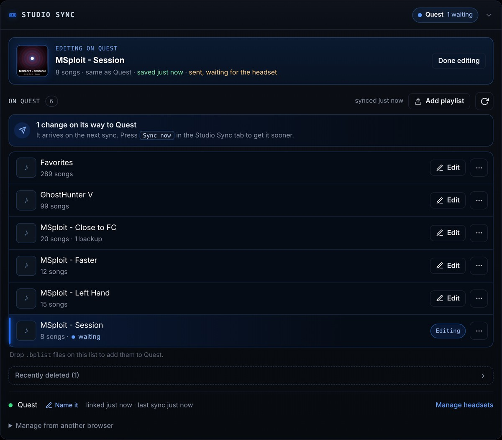

# Studio Sync

A Beat Saber Quest mod that links your headset to [Playlist Studio](https://spanky3651.github.io/Playlist-Studio/?utm_source=github&utm_campaign=studio-sync-readme#studio-sync). Playlists you send from Studio land on your headset, and the playlists already on your headset show up in Studio so you can edit them and send them back. No file to load.

Built for Beat Saber **1.40.8** (Scotland2). Needs **PlaylistCore**, **BSML** and **SongCore**, which mod managers install with it.

## Why
Getting a playlist onto a Quest usually means downloading a `.bplist`, plugging in, and copying it over with SideQuest or ADB. Studio Sync skips all of that. Build a playlist in Playlist Studio, press **Send to Quest**, and it's in your playlist list the next time you're back at the menu, with any songs you don't have downloaded for you.

It works the other way too. The playlists already on your headset show up in Studio, so you can open one on your phone or PC, rearrange it, add maps, and the changes land back on the headset on their own. Tweaking a session list between songs takes seconds.

- **No cable, no file copying.** Linking is a 6-character code, with no account or password.
- **Edit what's already on your Quest** from any browser, and changes save and send themselves.
- **Missing songs download on their own** when a playlist arrives.
- **Your in-game favorites in Studio.** See them, back them up, and favorite or unfavorite songs from any browser.
- **Nothing gets lost.** Every edit keeps a backup, deleted playlists wait 30 days in Recently deleted, and a new playlist never overwrites one with the same name.
- **More than one Quest?** Link them all and send to one or every headset.

## Use it
1. Install `StudioSync.qmod` with your mod manager (MBF, QuestPatcher).
2. In game, open the **Mods** tab in the panel left of song select, pick **Studio Sync** and press **Link**. A 6-character code appears.
3. In Playlist Studio, open **Studio Sync** and type the code.
4. In Studio, open **Save and send**, pick the **Studio Sync** tab and press **Send to Quest** for the playlist you're building.

The headset syncs when the game starts, each time you return to the main menu (at most every 2 minutes), when you open the tab, or right away with **Sync now**. While songs are downloading, **Sync now** is queued and runs as soon as they finish, and so does any automatic sync that came up in the meantime. Each sync:
- writes new playlists you sent from Studio as normal playlist files. It never overwrites one that's there: if the name is taken, the new one is saved as "Name (2)",
- still pulls playlists linked the older hosted way, until you move them onto the headset from Studio,
- shares your own playlists with Studio, so **On Quest** lists them with an **Edit** button (choose which ones under **Sharing...**; switched-off playlists are never uploaded and their stored copy is deleted),
- applies edits you sent back from Studio, replacing that playlist and keeping a backup,
- puts back a backup when you press **Restore...** on a playlist in Studio (the version it replaces is backed up too, so a restore can be undone).
- downloads the songs you don't have for any playlist it just added, edited or restored, using the same BeatSaver downloader as PlaylistManager's download button. The tab shows the progress. Your other playlists are never touched, and each playlist's auto-download can be switched off under **Options...** in the tab or from its menu in Studio.
- deletes a playlist when you press **Delete** in Studio. Nothing is erased: the playlist moves into its backups and shows in Studio under **Recently deleted** for 30 days, where **Restore** brings it back. After 30 days those backups are cleared.
- with **Also delete songs no other playlist uses** ticked in Studio's delete, deletes those songs too. It checks every playlist on the headset (including ones not shared with Studio), keeps your in-game favorites, and keeps songs BeatSaver no longer has, since those couldn't come back. Restoring the playlist downloads the deleted songs again.
- puts your playlists in the order you dragged them into in Studio (**My order**). Only the playlists Studio lists move, into the spots they already hold, so playlists you don't share and ones from other mods stay where they are. Dragging them in game still works; Studio's order applies again only after you change it there.
- runs **Clean up songs** when you press it on the storage card in Studio, the same way as **Clean up...** in game (below). It waits until you're back in the menu and nothing else is running.
- shares your in-game favorites with Studio (0.9.2 and later) and applies favorite and unfavorite changes from Studio one song at a time, so a heart changed in game and another changed in Studio both stay. Changes go into the game's favorites only while you're in the menu, and the game saves them right away. Switch **Favorites** off under **Sharing...** and Studio can't see or change them.

Song select's playlist list updates as soon as a sync adds, edits, deletes or reorders playlists, and the playlist you have open stays open. If a sync finishes mid-song, the list updates when you're back at song select.

## In game
Studio Sync lives in the **Mods** tab beside song select, next to mods like ReeSabers. **Sharing...** picks which of your playlists Studio can see and whether it sees your favorites, and **Options...** holds the progress line switch and auto-download for each playlist. What the last sync changed is listed under the buttons.

- **Get missing** downloads every song any of your playlists lists that the headset doesn't have. The tab shows how many are missing.
- **Clean up...** finds songs that aren't in any playlist and shows how many there are and how much space they take before anything happens. Delete, then Confirm, removes them. Favorites stay, and so do songs BeatSaver no longer has. The deleted songs are saved as a **Removed songs** playlist under **Recently deleted** in Studio for 30 days: restore it and they download again.

## In Playlist Studio
Studio Sync lives on its own tab in **Save and send** (the headset button in the top bar opens it). It lists every playlist your headset shares under **On Quest**. **Edit** opens one in Your Playlist, and your changes save and send themselves. The panel shows what's still on its way to the headset, **...** on each playlist has **Restore** and **Delete**, **Select** deletes several playlists at once, and **Recently deleted** brings back anything deleted in the last 30 days. Tap a playlist to see its maps without opening it, and drag the grips to set **My order**.

From 0.8.0, a storage card above the list shows the headset's songs, how much space they take, the songs no playlist uses and the free space, with a **Clean up songs** button. The headset works these out in the background at most every 30 minutes, and again after songs download or get deleted. Headsets on an older version don't show the card, and their order and clean up options stay hidden.

From 0.9.2, **Favorites** is pinned above the headset's playlists with its song count, how many aren't downloaded, and when Studio last backed it up. **Open** lists the songs with a heart to unfavorite or favorite each one, and hearts on songs in Your Playlist and in the search results do the same. Its **...** menu makes a playlist from your favorites, gets the missing songs, copies them to another headset (adds only), downloads them as a `.bplist`, and restores one of Studio's backups. A playlist's own menu has **Add all songs to favorites**. If the game is reset and the favorites come back empty, Studio offers to restore the last backup.

## What it touches
- Songs are deleted only when you ask: with a playlist deleted from Studio (if you tick the option), with **Clean up songs** in Studio, or with **Clean up...** in game. Favorites, WIP maps and songs BeatSaver no longer has are never deleted, and every deleted song can be downloaded again from Recently deleted for 30 days.
- Playlists linked the older hosted way are its own `StudioSync_<id>.bplist` files in `ModData/com.beatgames.beatsaber/Mods/PlaylistManager/Playlists`, removed when you move them onto the headset. Your own playlists are only removed when you press **Delete** in Studio, and even then a copy stays in backups for 30 days. Playlists switched off under **Sharing...** can't be changed or deleted from Studio.
- Your other playlists in that folder are read and uploaded to your private library so Studio can show them. One is changed only when you send an edit back from Studio: Studio's copy sets the title, author, description, songs and (if changed) the cover, and everything else in the file is kept. The previous version is saved to `Mods/StudioSync/backups/` (last 3 per playlist), and Studio lists those backups so you can restore one.
- Downloads playlists only from the Playlist Studio Worker it is linked to, and only `.bplist` files that parse as playlists (2.5 MB max). Songs come from BeatSaver through PlaylistCore, like PlaylistManager's download button.
- For the storage card it sends song counts and sizes, the free space, and the mod and game version. No song names or file lists.
- While **Favorites** is on under **Sharing...**, it sends the hashes of your favorited songs so Studio can show them. Studio keeps a few earlier copies so they can come back after a reset. Turning it off stops this.
- Its settings, including the device token, live in its config file under `ModData/com.beatgames.beatsaber/Configs/`. The Worker stores only a SHA-256 of that token.
- **Unlink** (here or in Studio) stops syncing. Playlists already on the headset stay.

## Build
Pushing to GitHub runs `.github/workflows/build.yml`, which restores dependencies with qpm, builds with the NDK and uploads `StudioSync.qmod` as an artifact.

Locally: `qpm restore`, then `qpm s qmod`.
