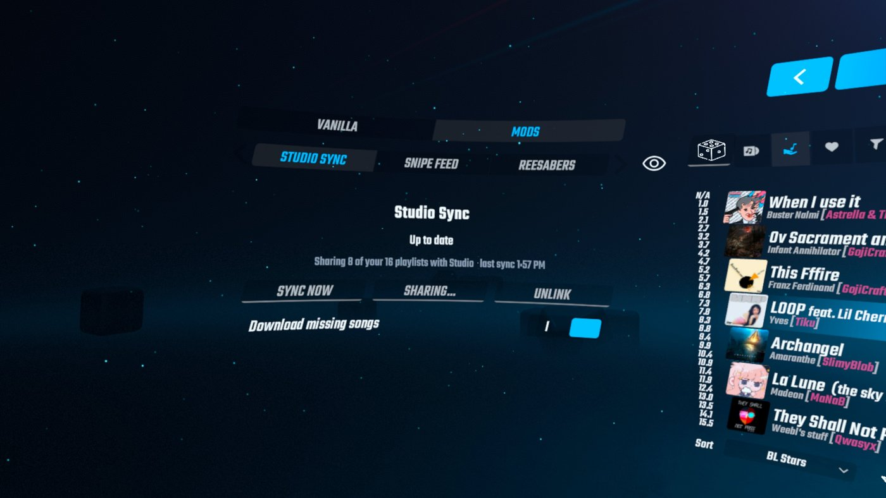
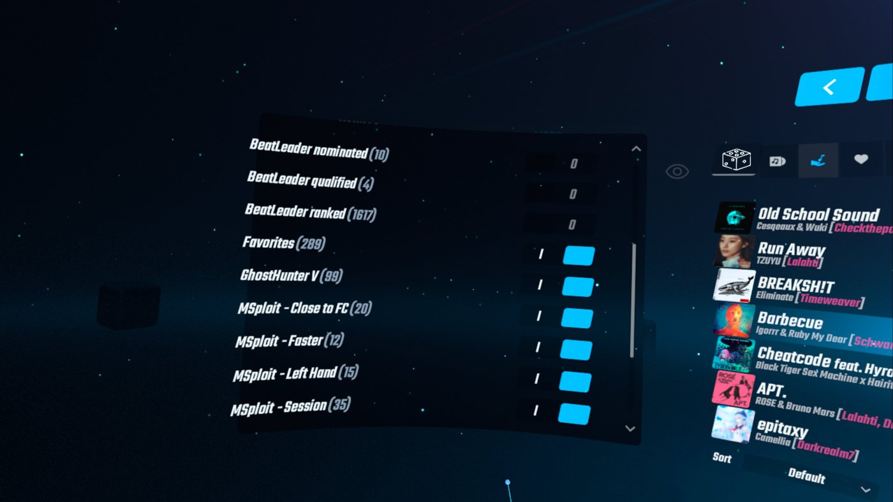

# Studio Sync

A Beat Saber Quest mod that links your headset to [Playlist Studio](https://spanky3651.github.io/Playlist-Studio/?utm_source=github&utm_campaign=studio-sync-readme#studio-sync). Playlists you send from Studio land on your headset, and the playlists already on your headset show up in Studio so you can edit them and send them back. No file to load.

Built for Beat Saber **1.40.8** (Scotland2). Needs **PlaylistCore** and **BSML**, which mod managers install with it.

## Use it
1. Install `StudioSync.qmod` with your mod manager (MBF, QuestPatcher).
2. In game, open the **Mods** tab in the panel left of song select, pick **Studio Sync** and press **Link**. A 6-character code appears.
3. In Playlist Studio, open **Studio Sync** and type the code.
4. In Studio's **Linked Quest** panel, press **Send to Quest** for the playlist you're building.

The headset syncs when the game starts, each time you return to the main menu (at most every 2 minutes), when you open the tab, or right away with **Sync now**. Each sync:
- writes new playlists you sent from Studio as normal playlist files. It never overwrites one that's there: if the name is taken, the new one is saved as "Name (2)",
- still pulls playlists linked the older hosted way, until you move them onto the headset from Studio,
- shares your own playlists with Studio, so **On your Quest** lists them with an **Edit** button (choose which ones under **Sharing...**; switched-off playlists are never uploaded and their stored copy is deleted),
- applies edits you sent back from Studio, replacing that playlist and keeping a backup,
- puts back a backup when you press **Restore...** on a playlist in Studio (the version it replaces is backed up too, so a restore can be undone).

## In game
Studio Sync lives in the **Mods** tab beside song select, next to mods like ReeSabers.

**Sharing...** opens the list of your playlists. Switch off any you don't want Studio to see.

## What it touches
- Studio-sent playlists are its own `StudioSync_<id>.bplist` files in `ModData/com.beatgames.beatsaber/Mods/PlaylistManager/Playlists`; only those are ever deleted.
- Your other playlists in that folder are read and uploaded to your private library so Studio can show them. One is changed only when you send an edit back from Studio: Studio's copy sets the title, author, description, songs and (if changed) the cover, and everything else in the file is kept. The previous version is saved to `Mods/StudioSync/backups/` (last 3 per playlist), and Studio lists those backups so you can restore one.
- Downloads only from the Playlist Studio Worker it is linked to, and only `.bplist` files that parse as playlists (2.5 MB max).
- Its settings, including the device token, live in its config file under `ModData/com.beatgames.beatsaber/Configs/`. The Worker stores only a SHA-256 of that token.
- **Unlink** (here or in Studio) stops syncing. Playlists already on the headset stay.

## Build
Pushing to GitHub runs `.github/workflows/build.yml`, which restores dependencies with qpm, builds with the NDK and uploads `StudioSync.qmod` as an artifact.

Locally: `qpm restore`, then `qpm s qmod`.

## Not yet
- Downloading missing songs automatically. Use PlaylistManager's download button for now.
